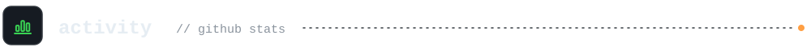
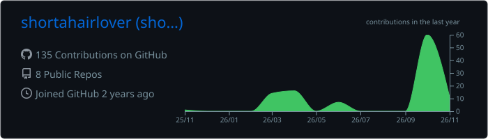
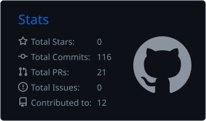
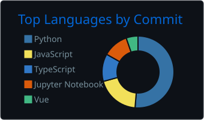
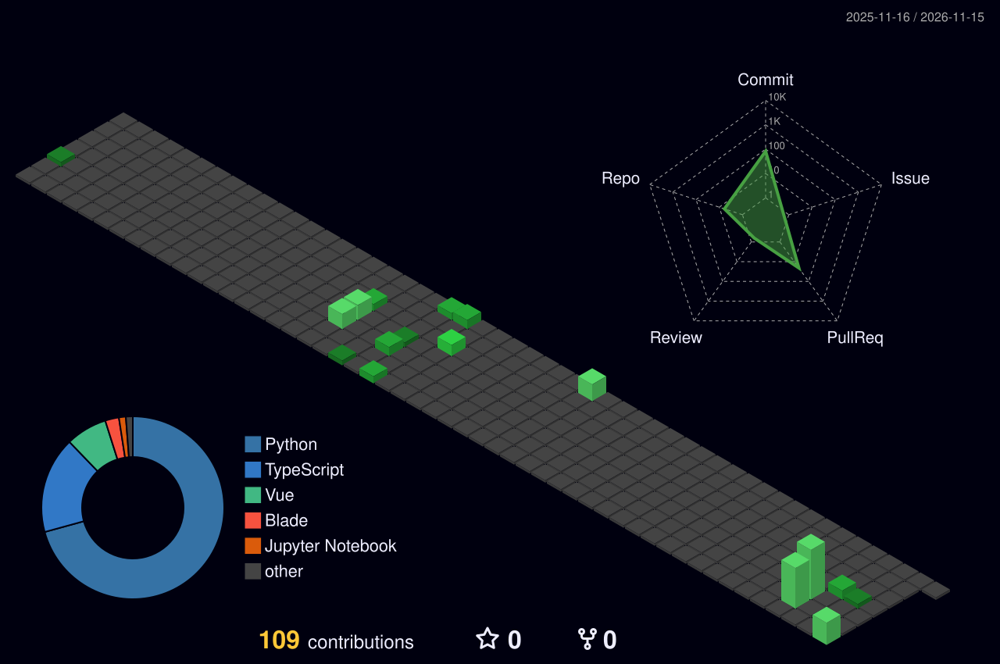
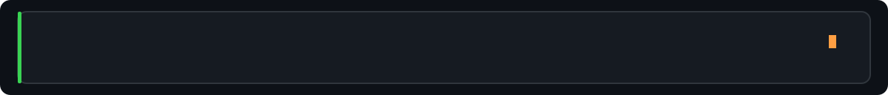

<p align="center">
  
</p>

<h1 align="center">Hey there, I'm Naufal</h1>

<p align="center">
  <a href="https://github.com/shortahairlover">
    
  </a>
</p>

<p align="center">
  
  <a href="https://github.com/shortahairlover?tab=followers"></a>
  
  
</p>

<p align="center">
  I'm an Informatics undergrad at <b>Telkom University</b> who likes turning manual, repetitive work into something that runs by itself.<br/>
  Lately that means <b>cloud-hosted automation</b> (AWS EC2, Telegram bots, Microsoft Graph) and <b>generative AI</b> (building a DDPM from scratch in PyTorch).
</p>

---


```python
class Naufal:
    name     = "Naufal Rafif Hidayat"
    based_in = "Sidoarjo, East Java, Indonesia"
    study    = "B.Sc. Informatics @ Telkom University (2023 - 2027)"

    focus = ["Cloud Infrastructure", "AI / Machine Learning", "Workflow Automation"]

    recently_did = [
        "Built a Telegram bot on AWS EC2 that writes straight into SharePoint (Telkomsel internship)",
        "Trained a class-conditional DDPM from scratch on CIFAR-10, reaching FID 16.43",
        "Data Scientist track at Coding Camp powered by DBS Foundation",
    ]

    learning_now = ["CI/CD on AWS", "Google Cloud", "Diffusion & generative models"]

    def say_hi(self):
        return "Let's build something that saves people time"
```


<table>
  <tr>
    <td align="center" width="25%"><b>Cloud & DevOps</b></td>
    <td></td>
  </tr>
  <tr>
    <td align="center"><b>AI & Data</b></td>
    <td>
      <br/>
      
      
      
      
    </td>
  </tr>
  <tr>
    <td align="center"><b>Web</b></td>
    <td></td>
  </tr>
  <tr>
    <td align="center"><b>Mobile & Backend</b></td>
    <td></td>
  </tr>
  <tr>
    <td align="center"><b>Tools</b></td>
    <td></td>
  </tr>
</table>


<table>
  <tr>
    <td width="50%" valign="top">
      
      <h3><a href="https://github.com/shortahairlover/ddpm-kelompok11">ddpm-kelompok11</a></h3>
      
      
      
      <p>A <b>Denoising Diffusion Probabilistic Model</b> written from scratch: a class-conditional U-Net with classifier-free guidance, trained on MNIST and CIFAR-10 on a 6 GB laptop GPU. Includes guidance sweeps, hyperparameter experiments and a DDIM sampler, reaching <b>FID 16.43</b> on CIFAR-10. I led the team as prompt engineer working alongside an AI coding agent.</p>
      <p><b>Stack:</b> Python, PyTorch, U-Net, DDIM, FID evaluation</p>
    </td>
    <td width="50%" valign="top">
      
      <h3><a href="https://github.com/shortahairlover/sipdana-v3">sipdana-v3</a></h3>
      
      
      
      <p>A personal finance manager with an <b>AI receipt scanner</b>: upload a photo of a receipt and Google Gemini pulls out the items and total, ready to save as a transaction. Also has JWT auth, real-time balance updates using database transactions, saving goals, and budgeting tips such as the 50/30/20 rule.</p>
      <p><b>Stack:</b> TypeScript, React, Node.js, Express, MySQL, Gemini API</p>
    </td>
  </tr>
  <tr>
    <td width="50%" valign="top">
      
      <h3><a href="https://github.com/shortahairlover/Wellnez-app">Wellnez-app</a></h3>
      
      
      <p>A wellness web app where users register, log in and manage their health schedule: add, edit and track activities from a personal dashboard. A React frontend talks to a <b>Spring Boot</b> REST backend built with Maven.</p>
      <p><b>Stack:</b> Java, Spring Boot, Maven, React, CSS</p>
    </td>
    <td width="50%" valign="top">
      
      <h3><a href="https://github.com/shortahairlover/LyricsHub">LyricsHub</a></h3>
      
      
      <p>A lyrics search site built on the Next.js App Router. Search for a song, open its lyrics on a dynamic <code>/lyrics/[artist]/[title]</code> page and save it to your favorites. A server-side API route proxies the Genius API so the key stays off the client.</p>
      <p><b>Stack:</b> Next.js, React, Tailwind CSS, Genius API</p>
    </td>
  </tr>
  <tr>
    <td colspan="2" valign="top">
      
      <h3><a href="https://github.com/shortahairlover/TugasLayout1">TugasLayout1</a></h3>
      
      
      <p>Mobile UI practice in Flutter: building layouts with rows, columns, stacks and containers, with a single codebase that targets Android, iOS, web and desktop.</p>
      <p><b>Stack:</b> Flutter, Dart</p>
    </td>
  </tr>
</table>

<p align="center">
  <a href="https://github.com/shortahairlover?tab=repositories">
    
  </a>
</p>


```text
* a7f3e21  (HEAD -> main)  Jul 2026 - Sep 2026
|          IT Unified Platform Adoption & Integration Intern @ Telkomsel
|          Cloud automation on AWS EC2: Telegram bots <-> Microsoft SharePoint
|
* 5c90d4b  Feb 2026 - Jun 2026
|          Data Scientist @ Coding Camp powered by DBS Foundation
|
* 31be7aa  Dec 2025 - Feb 2026
|          Community Contributor @ Dicoding Indonesia
|          Learned the basics of Google Cloud Platform (certified)
|
* 0e1d9c8  Aug 2023
|          Started B.Sc. Informatics @ Telkom University
|
* 9b2f6a0  Jul 2022 - Dec 2022
           Frontend Web Developer Intern @ Sinar Abipraya Voyage
           Responsive web front-ends with HTML, CSS, JavaScript & React
```



<div align="center">
  
</div>

<div align="center">
  
  
</div>

<div align="center">
  
</div>

<p align="center">
  
</p>


<p align="center">
  <a href="https://www.linkedin.com/in/naufal-rafif-hidayat-80309a2a2/" target="_blank"></a>
  <a href="mailto:naufalraf21@gmail.com"></a>
  <a href="https://github.com/shortahairlover" target="_blank"></a>
</p>

<p align="center">
  
</p>
